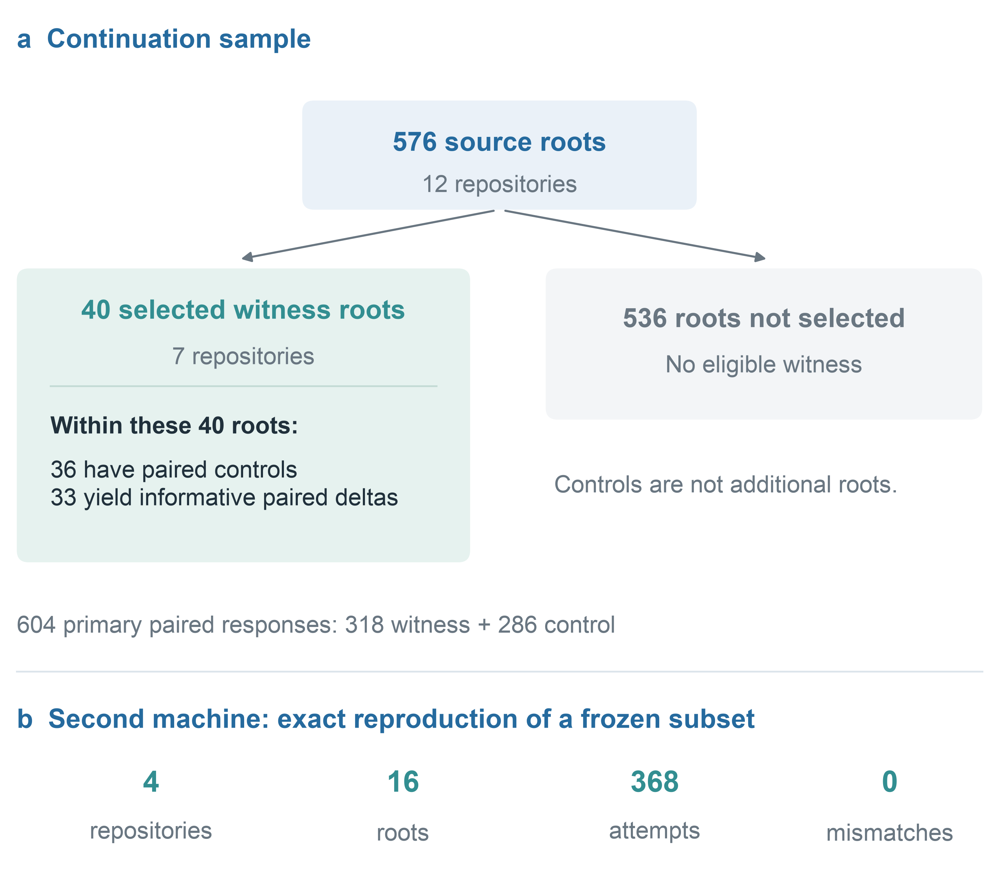

# Supplementary Results

## S8. Candidate-view and canonicalizer sensitivity

The complete root-positive surface is shown below. Every cell is an exact count over the same 96 immutable roots.

| Root-local candidate view | Raw | Textual (`text48`) | Structural |
|---|---:|---:|---:|
| Full panel (`L0`) | 57 | 57 | 70 |
| No heads ending in ? (`L-no-question`) | 42 | 42 | 64 |
| No `aesop` (`L-no-aesop`) | 44 | 44 | 65 |
| No `aesop?` (`L-no-aesop-question`) | 44 | 44 | 65 |
| No `aesop` + `aesop?` (`L-no-aesop-pair`) | 44 | 44 | 62 |
| No direct suggestions/control wrappers (`L-no-direct-wrapper`) | 42 | 42 | 64 |
| After genealogy deduplication (`L-mechanism-diverse`) | 30 | 30 | 33 |

Full-panel terminality decomposition:

| Canonicalizer | Terminal only | Nonterminal only | Both terminal and nonterminal | Neither |
|---|---:|---:|---:|---:|
| Raw | 21 | 34 | 2 | 39 |
| Textual (`text48`) | 21 | 34 | 2 | 39 |
| Structural | 15 | 47 | 8 | 26 |

The four categories are mutually exclusive and exhaustive. “Both” means that
the same root contains at least one terminal witness pair and at least one
nonterminal witness pair; it does not require one pair to be both terminal and
nonterminal.

The five root-local 23-candidate panels have frequencies 85, 6, 3, 1, and 1.
Their 19-candidate ordered intersection has SHA-256
`6734dce1ae2e6390502c57332f24db29e78bc5915f93e92263ceb2d3607acea9`.
The common panel contains `assumption`, `trivial`, `contradiction`, `simpa`,
`simp_all`, `aesop`, `aesop?`, `norm_num`, `omega`, `linarith`, `nlinarith`,
`ring`, `ring_nf`, `positivity`, `native_decide`, `constructor`, `fun_prop`,
`solve_by_elim`, and `exact?`.

| Common 19-candidate analysis | Raw | Textual | Structural |
|---|---:|---:|---:|
| Root positive | 57 | 57 | 70 |
| Nonterminal root positive | 35 | 35 | 54 |
| Cross-family root positive | 35 | 35 | 43 |
| Successful cross-head pairs | 421 / 16,416 | 421 / 16,416 | 472 / 16,416 |

Repository order is Carleson, FLT, Sphere-Packing-Lean, and Brownian Motion. All intervals below are archived descriptive repository-resampling outputs over four rates.

| Candidate view, structural endpoint | Repository rates | Macro mean | 95% resampling interval |
|---|---|---:|---|
| Full panel (`L0`) | 79.17%, 66.67%, 91.67%, 54.17% | 72.92% | [60.42%, 85.42%] |
| No heads ending in ? (`L-no-question`) | 66.67%, 66.67%, 91.67%, 41.67% | 66.67% | [47.92%, 85.42%] |
| No `aesop` (`L-no-aesop`) | 70.83%, 66.67%, 91.67%, 41.67% | 67.71% | [48.96%, 85.42%] |
| No `aesop?` (`L-no-aesop-question`) | 70.83%, 66.67%, 91.67%, 41.67% | 67.71% | [48.96%, 85.42%] |
| No `aesop` + `aesop?` (`L-no-aesop-pair`) | 66.67%, 58.33%, 91.67%, 41.67% | 64.58% | [47.92%, 83.33%] |
| No direct suggestions/control wrappers (`L-no-direct-wrapper`) | 66.67%, 66.67%, 91.67%, 41.67% | 66.67% | [47.92%, 85.42%] |
| After genealogy deduplication (`L-mechanism-diverse`) | 29.17%, 45.83%, 41.67%, 20.83% | 34.375% | [25.00%, 43.75%] |

For the primary genealogy-deduplicated structural view (archive label `L-mechanism-diverse`), nonterminal macro mean was 17.708% and cross-family macro mean was 34.375%. Every repository contributed each signal.

## S9. Endpoint confusion

| Comparison unit, `text48` versus structure | Both negative | Both positive | `text48` only | Structure only |
|---|---:|---:|---:|---:|
| All candidate pairs | 23,622 | 590 | 4 | 72 |
| Nonterminal cross-head pairs | 24,096 | 116 | 4 | 72 |
| Root primary indicator | 26 | 57 | 0 | 13 |
| Root nonterminal indicator | 41 | 36 | 0 | 19 |

Raw and `text48` agreed exactly in the archived comparisons. The confusion table establishes measurement-construct sensitivity only.

## S10. Same-server exact-comparison accounting

| Mode | Roots | Candidate attempts | Condition | Outcome |
|---|---:|---:|---|---|
| M0 | 96 | 2,208 | Historical order | Exact source endpoint content |
| M1 | 96 | 2,208 | Reverse order | Exact M0 |
| M2 | 96 | 2,208 | Seeded shuffle 500052 | Exact M0 |
| M3 | 96 | 2,208 | Seeded shuffle 500053 | Exact M0 |
| M4 | 96 | 2,208 | Seeded shuffle 500054 | Exact M0 |
| M5 | 96 | 2,208 | One fresh Lean process per branch | Exact M0 |

All six modes matched the prespecified endpoint content exactly. Comparison used the content fields defined in Section S6, with zero content mismatches and zero manual reconciliation.

## S11. External-frame repository rates

| Repository | `L0` rate | Frequency after genealogy deduplication |
|---|---:|---:|
| `PatrickMassot/GlimpseOfLean` | 47.92% | 22.92% |
| `AfonsoBitoque/LeanServer` | 62.50% | 39.58% |
| `dissensus-ai/lean-formalizations` | 79.17% | 22.92% |
| `leanprover-community/batteries` | 50.00% | 4.17% |
| `bergmannjg/Regex` | 60.42% | 4.17% |
| `Verified-zkEVM/VCVio` | 95.83% | 79.17% |
| `leanprover-community/lean-auto` | 22.92% | 4.17% |
| `YaelDillies/misc-yd` | 60.42% | 25.00% |
| `MichaelStollBayreuth/LegendreQF` | 75.00% | 27.08% |
| `verse-lab/Lentil` | 41.67% | 8.33% |
| `AmosNico/validator` | 83.33% | 39.58% |
| `spectra-research/asymptotic-tensor-rank-semicontinuity` | 50.00% | 18.75% |

Following the lexical-label correction described in Section S3, the full-panel macro mean is 60.7639% (350/576 roots), with a descriptive two-level bootstrap interval [49.1319%, 72.2222%]. The genealogy-deduplicated macro mean remains 24.6528% (142/576), with a recomputed interval [13.8889%, 37.6736%]. The correction uses stored executions and adds no new Lean calls.

## S12. Bounded-continuation responses

| Item | Archived value |
|---|---:|
| Source external-frame roots accounted | 576 |
| Selected witnesses | 40 roots / 7 repositories |
| Valid within-root controls | 36 roots / 6 repositories |
| Informative paired deltas | 33 |
| Primary cells | 1,208 |
| Determinism-audit cells | 112 |
| Total cells | 1,320 |
| Successful probe executions | 211 |
| Recorded tactic failures | 1,109 |
| Timeouts | 0 |
| Determinism mismatches | 0 |
| Manual reconciliations | 0 |

Unified denominators distinguish selected roots, side--probe execution cells,
and paired-response units:

| Component | Role | Repeat kind | Unit | Planned | Observed | Valid |
|---|---|---|---|---:|---:|---:|
| Source frame | all | selection | root | 576 | 576 | 576 |
| Selected witnesses | witness | selection | root | 40 | 40 | 40 |
| Within-root controls | control | selection | root pair | 36 | 36 | 36 |
| Continuation execution | witness | primary | side--probe cell | 636 | 636 | 636 |
| Continuation execution | control | primary | side--probe cell | 572 | 572 | 572 |
| Continuation execution | witness | determinism audit | side--probe cell | 112 | 112 | 112 |
| Paired response | witness | primary | pair--probe | 318 | 318 | 318 |
| Paired response | control | primary | pair--probe | 286 | 286 | 286 |
| Paired response | witness | determinism audit | pair--probe | 56 | 56 | 56 |
| Determinism comparison | all | audit | side--probe cell | 112 | 112 | 112 |
| All execution | all | all | side--probe cell | 1,320 | 1,320 | 1,320 |

| Primary response category | Count |
|---|---:|
| Both fail, same category | 486 |
| Both succeed, same structural endpoint | 52 |
| Both succeed, different structural endpoints | 23 |
| Left succeeds only | 18 |
| Right succeeds only | 25 |

The archived measures A, B, and C use probes for which at least one side succeeds. A is the fraction with exactly one successful side; B also counts probes where both sides succeed but reach different structural endpoints; C is the fraction where both sides succeed at the same structural endpoint. D indicates whether a root has any discordant probe of either kind. Their witness macro means, with equal repository weights, were A=0, B=0, C=1, and D=0. The all-concordant empirical bootstrap produced A and B intervals `[0,0]`, C interval `[1,1]`, and a B empirical one-sided value of 0. The paired-control delta in C was 0.958333 with interval [0.875,1.0]. The limited witness, control, and repository support makes these descriptive observations rather than evidence of general continuation equivalence; an all-concordant empirical bootstrap does not bound unseen discordance.

## S13. Second-machine exact subset

The second-machine subset contains four repositories, four roots per repository, 16 roots, and 368 candidate attempts. Every prespecified field matches the frozen external-frame projection. The mismatch ledger is empty; its archived SHA-256 is `e3b0c44298fc1c149afbf4c8996fb92427ae41e4649b934ca495991b7852b855`. The study records zero manual reconciliation and the immutable decision label `cross_machine_exact`.

**Supplementary Figure S1. Continuation sample and reproduction on a second machine.** Of 576 source roots, 40 supply an eligible witness and 536 do not. The 36 paired controls belong to the selected witness roots; they are not an additional group of roots. Of these, 33 yield informative paired deltas. The lower panel reports exact reproduction of the frozen 16-root projection on a second machine. This portability result does not alter the external-frame or continuation decisions.

## S14. Prespecified downstream branch selection

The frozen design contains four repositories, 16 roots, 16 same-endpoint witness pairs, 16 different-endpoint controls, and eight probes per pair. Full expansion contains 512 cells. Representative pruning contains 384 cells because it retains one branch for each witness pair but both sides of every control. Initial candidate execution is unchanged.

| Quantity | Full expansion | Representative pruning |
|---|---:|---:|
| Downstream calls | 512 | 384 |
| Distinct successful strict endpoints | 26 | 26 |
| Distinct endpoints per 100 calls | 5.078 | 6.771 |
| Pair--probe combinations with any terminal success | 10 | 10 |
| Terminal-success cells | 17 | 12 |

All 896 frozen cells were reconstructed in fresh Lean processes, every attempt ordinal was one, all overlap cells reproduced exactly, and both scientific retries and manual reconciliation were zero. The successful strict-endpoint union and the set of pair--probe combinations with any terminal success were preserved. However, two of 128 side-specific witness--probe comparisons differed, affecting two of 16 witness pairs. The exact archived label is `coverage_loss_detected`: union-level coverage was preserved, while side-specific coverage or multiplicity was not lossless.

The scheduled-call estimand and coverage-preservation estimand are reported
separately. A positive call reduction cannot make the coverage estimand pass,
and union-level endpoint equality cannot erase side-specific mismatches.

Both side-specific differences occurred for `simp_all`/`aesop` witness pairs. Probe success and strict endpoints agreed, while generated local-instance display names differed. This explains the response-signature discrepancy without implying lossless pruning: terminal-success multiplicity was 17 versus 12, despite preservation of the strict-endpoint union.

## S15. Selected-root provenance validation

All 96 selected confirmation roots have a recorded selection rank, theorem and
file identity, source hash, trace hash, and repository commit. The 24 ranks are
unique within each of the four repositories; all selected-file, source, and
trace hashes are internally consistent. The archive also records the reported
eligible-root totals (653, 318, 394, and 167) and three repository-level
exclusions. However, the compact archive does not contain every nonselected
eligible-root record. It can therefore verify selected-row identities and
ranks, but cannot prove from the deposited material alone that the 24 selected
ranks are globally the first 24 among each complete eligible frame. This is a
limit on reconstructing the original selection from the compact archive.

## S16. Immutable offline reanalysis

The five-panel reconstruction, common-19 analysis, complete 7-by-3 matrix,
four-way terminality table, unified denominators, provenance ledger, and split
downstream estimands were regenerated from the five locked confirmation, sensitivity,
initial external-frame, continuation, and local branch-selection archives. An independent offline audit regenerated all
17 derived files byte-for-byte with zero mismatches and zero manual
reconciliation. The reanalysis leaves the original outcomes unchanged.

## S17. Prospectively frozen external hard-root confirmation

The confirmation retained 64 roots, 32 from miniF2F and 32 from PutnamBench,
and completed four paired policies per root. The 256 jobs contained 14,688
actual Lean process calls/cells. All candidate stages were exact, all cells used
fresh processes, every attempt ordinal was one, and scientific retries and
manual reconciliation were zero.

| Policy | Candidate calls | Downstream calls | Actual process calls | Selected depth-2 branches | Unique complete-case endpoints |
|---|---:|---:|---:|---:|---:|
| Full expansion | 1,344 | 2,856 | 4,200 | 357 | 410 |
| Endpoint selection | 1,344 | 1,800 | 3,144 | 225 | 410 |
| Deduplication by tactic head | 1,344 | 2,856 | 4,200 | 357 | 410 |
| Random control matching child counts at each node (`fixed_budget_random`) | 1,344 | 1,800 | 3,144 | 225 | 381 |

Endpoint selection saved 1,056 actual Lean process calls relative to full
expansion, a reduction of 25.1429%. The paired mean saving was 16.5 calls per
root, the dataset-stratified bootstrap 95% interval was [14.5,18.5], and the
protocol-specified normal-approximation one-sided 95% lower bound, `mean(d) - z_0.95 * sd(d) / sqrt(n)`, was 14.8196. Deduplication
by tactic head saved no calls. Equal-budget random
pruning matched the endpoint call count but did not preserve the
complete-case strict-endpoint union and matched the full per-root endpoint set
on 47/63 roots, versus 63/63 for endpoint selection.

One miniF2F root was unevaluable for paired coverage after a Lean internal panic in three policy cells. Its launched calls remain included in efficiency, and its coverage outcome is neither replaced nor imputed. Full-sample coverage is therefore unavailable.

The remaining 63 roots form a non-prespecified complete-case sensitivity set.
Full and endpoint selection each solved zero roots; paired coverage loss was
zero and its one-sided 95% Wilson score upper bound was 0.0411768. The strict-endpoint union
and every per-root endpoint set were identical between full and endpoint
selection on these 63 roots. Because no root was solved and one frozen root
was unevaluable, these observations do not establish theorem-solve-rate
improvement or complete-sample coverage noninferiority.

## S18. Interpretation scope

This section states the scope of the reported measurements and their reuse. Final numerical outcomes are given in the corresponding result sections.

| Scope or exception | Extended record | Consequence for interpretation |
|---|---|---|
| Lean version and repository frame | Scientific execution is restricted to Lean v4.27.0 and pinned commits. The untouched confirmation contains four repositories; the initial external frame contains 12 screened lineage representatives; the strict current-commit frame contains 32 lineage-deduplicated representatives. None is a probability sample, and the lineage screen does not prove statistical independence. | Reported macro means and descriptive frame-resampling intervals describe frozen frames and do not estimate ecosystem-wide frequency or later-version portability. |
| Confirmation-root provenance | The compact confirmation archive preserves selected-row identities, ranks, eligible counts, source hashes, and selected-file hashes, but not every nonselected eligible-root ledger from the inherited corpus protocol. | The 96 selected rows can be reconstructed exactly, but every eligible-to-selected ranking cannot be regenerated from the compact bundle alone. |
| Candidate panels | The recurrence experiment uses a 32-entry source library and deterministic 23-alternative root-local panels. The hard-root experiment uses a separate 21-program expansion panel. The multi-step experiment combines 24 generic actions with disclosed authored-witness actions. | A zero indicator means that no witness appeared in the frozen panel, not that no Lean program could produce one. Multi-step solvability does not measure autonomous candidate acquisition. |
| Transition scope | Admitted recurrence pre-states contain one goal. The primary recurrence response covers one tactic invocation, and the continuation experiment adds one independent probe. The oracle-assisted multi-step confirmation follows authored-witness-depth-2--6 trajectories. | Arbitrary trajectories outside the disclosed action set and multi-goal starting states require separate evaluation. |
| Endpoint abstraction | Textual and structural canonicalizers exclude proof terms, runtime, messages, internal traces, and selected metadata. Text-only and structure-only matches are both observed. The completed multi-step evaluation uses only `text48_v1`. | Prespecified endpoint equality is not proof-term identity, semantic equivalence, or cost equivalence. No completed same-root multi-step comparison yet measures the consequences of textual versus strict structural keys. |
| Continuation information | The observed witness sample was all-concordant on its informative denominator, but realized witness, control, and repository support remained restricted. | The authoritative archive label remains `continuation_inconclusive`; the observed cells do not bound arbitrary unseen trajectories. |
| Local branch selection | Representative selection reduced scheduled downstream calls by 25% and preserved the strict-endpoint union. Two side-specific witness--probe comparisons changed response multiplicity through generated local-instance display names. | The exact label remains `coverage_loss_detected`; Section S14 reports the coverage comparison. |
| Hard-root efficiency | Endpoint selection saved 1,056 actual Lean process calls. One root lacks the paired coverage outcome under the frozen no-retry rule, and no complete-case root was solved by either principal policy. | Process-call efficiency is measured on all 64 roots; coverage and theorem-solve-rate improvement are not established. Section S17 reports the complete-case sensitivity analysis. |
| Oracle-assisted multi-step solvable search | Endpoint selection solved 59/64 roots versus 58/64 for full expansion, with 0/64 full-only losses and 1,207 fewer tactic invocations. Every policy received the root's authored-witness actions. | The one-sided 95% Wilson upper bound was 0.04056 under a binomial working model. All savings occurred in depth-3--6 roots. The solve-count difference is not interpreted as superiority, and candidate acquisition was not evaluated. |
| Reproducibility | Same-server re-execution changes implementation, order, and process isolation. Second-machine re-execution covers 16 frozen roots and 368 attempts. | Exact prespecified-content agreement is established only on the re-executed scopes. |
| Public availability | Zenodo version 1.22.2 contains eleven unchanged archives, a source snapshot, manifests, licence records, and the final correction layer; access details appear in the Artifact Manifest. | Archive integrity and corrected-analysis reconstruction are separate checks. Neither adds a new scientific execution. |

## S19. Oracle-assisted known-solvable multi-step branch-selection confirmation

The immutable archive and protocol use the historical label `witness-injected`; the main manuscript describes this as search with supplied actions because every policy receives disclosed authored-witness actions. This is also called oracle-assisted search in the supplementary methods. The frozen candidate frame contained 192 roots, and live qualification wrote 192/192 receipts. There were 142 qualification passes and 50 failures, including one operational failure. The qualified confirmation pool contained 38 authored-depth-2 roots and 55 authored-depth-3--6 roots. The frozen confirmation used 32 roots from each stratum and did not replace any root manually. This balanced 64-root total was a pre-outcome computational budget; no power or precision calculation for the sample size is recorded. The 16-root pilot completed all 64 jobs without operational failure, and full expansion produced 13 multi-step solves before confirmation was frozen.

Confirmation completed 256/256 root--policy jobs. All 64 roots had four policy receipts, every attempt ordinal was one, and operational failures, scientific retries, and manual reconciliations were all zero. Every reported solve used at least two external tactic invocations.

| Policy | Multi-step solved roots | Solve rate | Tactic invocations | Expanded nodes | Observed endpoint union | Median time to first proof (s) | Wall clock (s), descriptive |
|---|---:|---:|---:|---:|---:|---:|---:|
| Full expansion | 58/64 | 90.625% | 10,147 | 417 | 772 | 5.182 | 1,772.36 |
| Endpoint selection | 59/64 | 92.188% | 8,940 | 373 | 836 | 5.168 | 1,604.95 |
| Deduplication by tactic head | 56/64 | 87.500% | 10,019 | 411 | 809 | 5.093 | 1,731.78 |
| Random control matching child counts at each node (`fixed_budget_random`) | 40/64 | 62.500% | 14,269 | 563 | 1,025 | 4.556 | 2,238.03 |

For the prespecified paired coverage estimand, endpoint selection had zero losses and one gain relative to full expansion. There were no operationally incomplete pairs to count under the worst-case rule. The full-only loss fraction was therefore 0/64, with a one-sided 95% Wilson score upper bound of 0.0405595. This value is a Wilson uncertainty summary under the specified binomial working model; it is not a population bound for mathlib, other repositories, or other canonicalizers. The 59/64 versus 58/64 solve counts are not interpreted as evidence of superiority. Full and endpoint per-root endpoint sets were exactly equal on 58/64 roots (90.625%); this diagnostic was not a universal endpoint-preservation result.

Endpoint selection used 1,207 fewer tactic invocations than full expansion, an 11.895% reduction. The counter includes every candidate executed to observe and classify an endpoint, including candidates whose children are not retained. The paired mean full-minus-endpoint saving was 18.859 invocations per root, with standard deviation 49.090. The authored-depth-stratified 20,000-replicate percentile-bootstrap 95% interval was [8.828,30.703]. The separately frozen normal-approximation one-sided 95% lower bound, `mean(d) - z_0.95 * sd(d) / sqrt(n)`, was 8.766. Here d is the paired saving in invocations, n is the number of roots, and z_0.95 is the 95th percentile of the standard normal distribution.

The per-root saving distribution was concentrated: 13/64 roots had positive savings, 51/64 had zero savings, and none had negative savings; the minimum, first quartile, median, and third quartile were all 0, and the maximum was 234 invocations. In the 32 authored-depth-2 roots, both policies executed 1,184 invocations and solved 32/32 roots, so the observed saving was 0. In the 32 authored-depth-3--6 roots, full expansion executed 8,963 invocations and solved 26/32 roots, whereas endpoint selection executed 7,756 invocations and solved 27/32. The 1,207-invocation difference is 13.466% of the full-policy total in that stratum and accounts for the entire aggregate saving. These are exact descriptive strata, not post hoc inferential subgroups.

Endpoint collisions were observed by the endpoint policy on 52/64 roots: 22/32 depth-2 roots contributed 79 collisions, and 30/32 depth-3--6 roots contributed 681. The depth-2 stratum therefore contained endpoint collisions without call savings. All observed savings occurred in the deeper stratum, a pattern consistent with greater opportunities to avoid subsequent branch expansion; depth was not experimentally manipulated.

The independent audit reconstructed every policy's solve, invocation, expanded-node, and operational-failure totals from immutable receipts. It verified all 256 job identities, exact transition-to-invocation accounting, all attempt ordinals equal to one, zero scientific retries, and zero manual reconciliation. The Artifact Manifest identifies the exact result bundle and protocol.

This experiment executes real multi-step LeanDojo interaction, but every policy receives the root's independently replayed authored-witness actions. It therefore evaluates search-tree branch selection after candidate acquisition has been deliberately neutralized. It does not establish autonomous tactic generation, proof-term identity, semantic state identity, general wall-clock superiority, or performance beyond the frozen mathlib4 benchmark partition.

### S19.1. Source-file-cluster sensitivity

A post-outcome sensitivity resampled all 63 source-file clusters, retained every sampled file's roots together, and equally weighted the two authored-depth stratum means. There were 32 files represented in each stratum, with one file shared between strata; its two roots were always sampled together. With 20,000 resamples and PCG64 seed 20260918, the percentile interval for mean paired call savings was [8.89, 30.75], compared with the root-stratified interval [8.83, 30.70]. Because nearly every file contributes a single root, this check addresses little additional dependence. Shared mathematical dependencies and theorem-family clustering remain outside this sensitivity. All observed coverage losses were zero, making an ordinary nonparametric loss bootstrap degenerate; it supplies no valid zero-risk guarantee. The reported Wilson bound retains its explicitly stated binomial working-model interpretation.

## S20. Strict current-v4.27 external replication

The zero-scientific-tactic recruitment stage exhausted its 52-repository frozen frame. Thirty-three repositories passed qualification, four were definitively ineligible, and 15 were operationally unresolved; lineage analysis retained 32 lineage-deduplicated representatives. The strict external replication froze all 32 representatives and 16 authored-replay-qualified roots per repository before scientific execution. Every one of the 512 roots produced a worker receipt, all 512 were evaluable, and all 11,776 requested candidate invocations were recorded. There was no missing-root imputation, scientific repository replacement, or manual reconciliation.

| Repository | Full-panel frequency | Frequency after genealogy deduplication | Cross-family roots | Nonterminal roots |
|---|---:|---:|---:|---:|
| `Paraxiom/scheming-proofs` | 62.50% | 31.25% | 5/16 | 8/16 |
| `NethermindEth/poseidon2-fv` | 68.75% | 37.50% | 7/16 | 11/16 |
| `beowulf127/wowii144-lean` | 75.00% | 25.00% | 9/16 | 11/16 |
| `galvusdamor/lean4-search-algorithms` | 68.75% | 12.50% | 5/16 | 10/16 |
| `LoganEvans/litlib4` | 81.25% | 12.50% | 5/16 | 13/16 |
| `danuaemx/lean-257-2` | 93.75% | 37.50% | 10/16 | 15/16 |
| `mirajcs/IsoperimetricInequality` | 100.00% | 37.50% | 10/16 | 16/16 |
| `katydid/paper-2026-verified-filter-lean` | 31.25% | 18.75% | 3/16 | 2/16 |
| `Pjotr5/IndependentTransversals` | 18.75% | 6.25% | 2/16 | 3/16 |
| `fc0web/lean-d-fumt8` | 81.25% | 81.25% | 13/16 | 0/16 |
| `ericmerle3789/collatz-conditional-cycles` | 93.75% | 50.00% | 9/16 | 15/16 |
| `rupakm/leslie` | 31.25% | 12.50% | 5/16 | 1/16 |
| `AxiomMath/erdos-public` | 81.25% | 31.25% | 7/16 | 13/16 |
| `ilyasergey/lean-move` | 100.00% | 31.25% | 6/16 | 13/16 |
| `TPColor/bastien-khormali-conjecture` | 100.00% | 31.25% | 8/16 | 16/16 |
| `primateria/erdos608` | 75.00% | 18.75% | 4/16 | 12/16 |
| `Jostamon/erdos274-hs-abelian` | 62.50% | 43.75% | 8/16 | 9/16 |
| `paolino/keri-lean` | 12.50% | 12.50% | 2/16 | 1/16 |
| `abcrtzyn/sudoku_prover` | 87.50% | 12.50% | 4/16 | 12/16 |
| `mkwatson/unique-sums-notes` | 93.75% | 56.25% | 9/16 | 14/16 |
| `MaskoMys/Collatz-Binary-Topology` | 100.00% | 12.50% | 10/16 | 16/16 |
| `korbexmachina/GlimpseOfLean` | 62.50% | 31.25% | 6/16 | 5/16 |
| `qscqesze/graffiti-pc-conjecture-141` | 31.25% | 6.25% | 5/16 | 5/16 |
| `Robertboy18/aint26-lean-solutions` | 68.75% | 25.00% | 4/16 | 11/16 |
| `KitaKen1/bezier-bernstein-voronovskaja-lean` | 100.00% | 18.75% | 3/16 | 16/16 |
| `repowazdogz-droid/omega-lean-proof` | 37.50% | 12.50% | 3/16 | 3/16 |
| `grenewode/LeanServer` | 62.50% | 37.50% | 8/16 | 4/16 |
| `alexoltean61/msphml-lean` | 100.00% | 37.50% | 8/16 | 8/16 |
| `scidonia/vericode` | 12.50% | 6.25% | 2/16 | 0/16 |
| `pablo-vs/discrete-game-theory` | 62.50% | 6.25% | 1/16 | 9/16 |
| `YijunYuan/HarderNarasimhan` | 93.75% | 43.75% | 8/16 | 15/16 |
| `tobiasosborne/ProjSeminorm` | 68.75% | 43.75% | 7/16 | 11/16 |

The corrected full panel produced 355/512 positive roots, an equal-weight repository macro frequency of 0.693359375, median repository frequency 0.71875, and descriptive two-level interval [0.591796875, 0.7890625]. Repository frequencies ranged from 0.125 to 1.0. Leave-one-repository-out means ranged from 0.6834677 to 0.7116935. The 512 roots came from 213 files; equal weighting of files within repositories gave 0.7058819971.

The genealogy-deduplicated view retained 141/512 positives (0.275390625; interval [0.208984375, 0.34765625]). Cross-family witnesses occurred on 196 roots in all 32 repositories, and nonterminal witnesses on 298 roots in 30 repositories. There were 124 distinct cross-head pairs, 87 recurring in at least two repositories. All roots were evaluable, so complete-case and missingness-bound estimates coincide.

The original deterministic audit reproduced the original labels and summaries; it did not detect the label-extraction defect. The correction layer independently checked the direct pair predicate against endpoint-group aggregation and reproduced every archived root indicator before relabeling. The archived full-panel count was 277; the corrected count is 355. Candidate programs, their order, execution statuses, and structural endpoint hashes are unchanged. Corrected intervals use 20,000 repository/root resamples, NumPy PCG64 seed 20260918, and linear percentile quantiles. This post-outcome correction supersedes the external summary statistics, not the frozen execution frame or source archives.

### S20.1. Root-level multiplicity from the same executions

These descriptive summaries use all 512 roots and the full 23-candidate panels. Successful candidates include initial-state-preserving executions; endpoint classes include their initial endpoint when present. Duplicate successful candidates equal successful candidates minus distinct structural endpoints. Qualifying pairs instead require different lexical heads and a shared non-initial endpoint, matching the primary witness definition. Quartiles use linear interpolation.

| Per-root quantity | Minimum | Q1 | Median | Q3 | Maximum |
|---|---:|---:|---:|---:|---:|
| Successful candidates | 0 | 2 | 4 | 7 | 15 |
| Distinct successful structural endpoints | 0 | 2 | 3 | 3 | 6 |
| Qualifying cross-head candidate pairs | 0 | 0 | 1 | 4 | 67 |
| Duplicate successful candidates | 0 | 0 | 1 | 3 | 12 |

The binary root indicator and these multiplicity summaries answer different questions: occurrence of at least one witness versus the number of observed alternatives or agreements. None is a predicted percentage search speedup. Root-level corrected rows and the correction script accompany the manuscript revision as an additional analysis layer.
